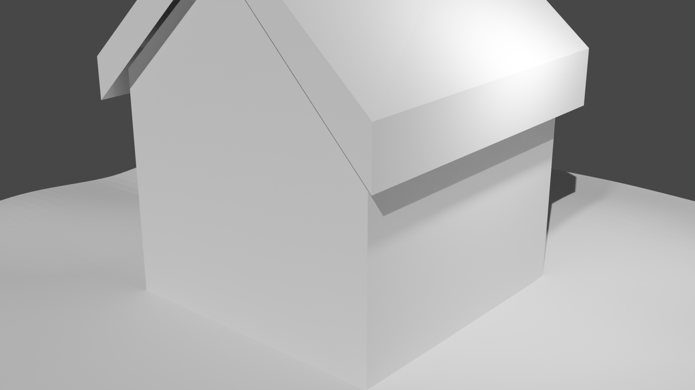

# 🎨 Blender 3D Art & Study Gallery

A showcase of 3D modeling, simulation, and rendering practices created with **Blender 3.6**.  
High-resolution stills rendered using the **Cycles Render Engine**.

> 💡 **Notice**: All artworks in this repository were created for non-commercial personal study and practice purposes, referencing various public tutorials and creative artworks by 3D artists.

---

## 🖼️ Gallery & Project Showcase

### 🍄 Mushroom Terrarium in a Bottle
Stylized glass bottle terrarium containing mushrooms, foliage, and ambient sparkles with glass refractions.

  

* **Source File**: [`mushroom_vase.blend`](mushroom_vase.blend)
* **Highlights**: Glass shader refraction, organic mushroom modeling, ambient lighting

---

### 🏠 Snowy Winter Cabin
A cozy, snow-draped cottage scene with glowing warm windows, surrounded by winter pine trees.

  

* **Source File**: [`house.blend`](house.blend)
* **Highlights**: Volumetric snow layers, architectural modeling, warm interior emission lighting

---

### 🍩 Donut Tutorial Study
The classic 3D initiation journey inspired by Blender Guru's famous tutorial series.

  

* **Source File**: [`donuttutorial.blend`](donuttutorial.blend)
* **Highlights**: Subsurface scattering, glossy icing sculpting, procedural texturing

---

### 🛏️ Pillow & Blanket (Cloth Simulation)
Bedding modeling practice exploring soft-body fabric dynamics, realistic wrinkles, and cloth simulation.

  

* **Source File**: [`pillow,blanket.blend`](pillow,blanket.blend)
* **Highlights**: Cloth physics simulation, organic folds, soft-surface modeling

---

### 📦 House Blocking & Structure Practice
Basic architectural blocking focusing on proportions, geometry, and clean topology.

  

* **Source File**: [`untitled.blend`](untitled.blend)
* **Highlights**: Foundational hard-surface modeling, scale and proportion study

---

## 📚 References & Cheatsheet
* [`Blender 3.0 HotKeys.pdf`](Blender%203.0%20HotKeys.pdf) — Quick shortcut guide and reference sheet for Blender navigation and modeling workflows.

---

## 📌 Credits & Disclaimer
* All models and renders are intended solely for educational, personal skill development, and portfolio purposes.
* All original ideas, designs, and tutorial concepts belong to their respective creators and artists.
