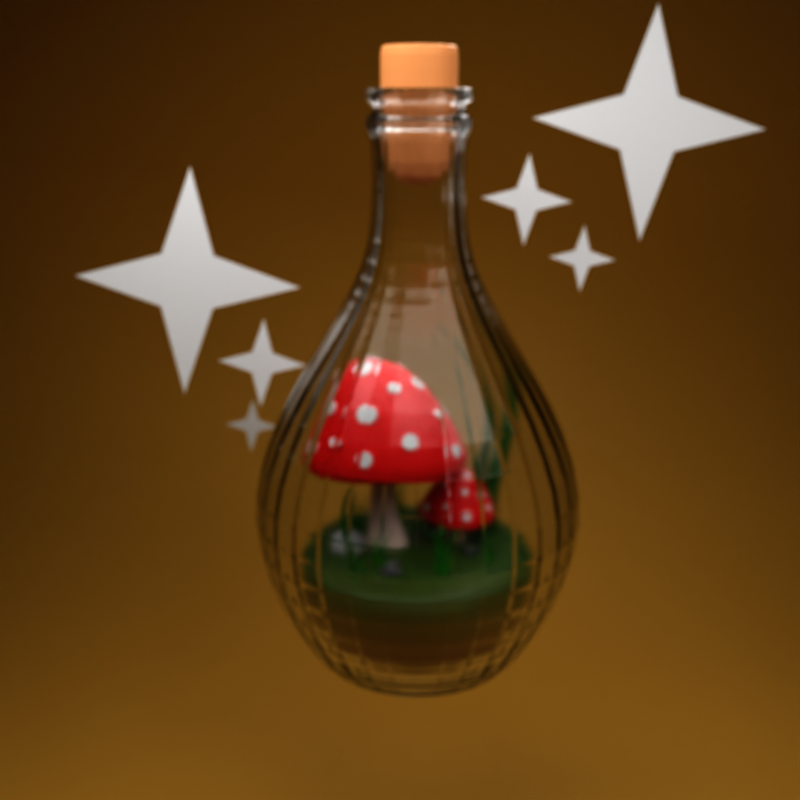
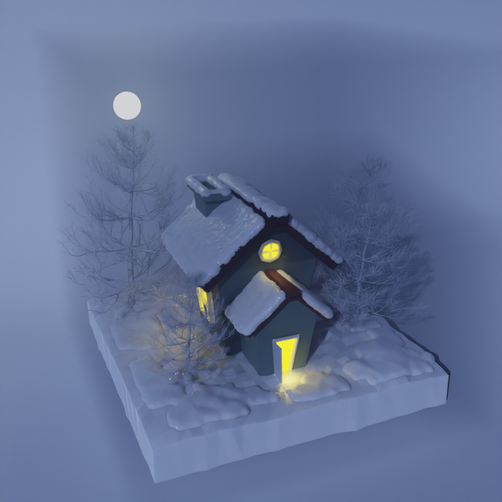
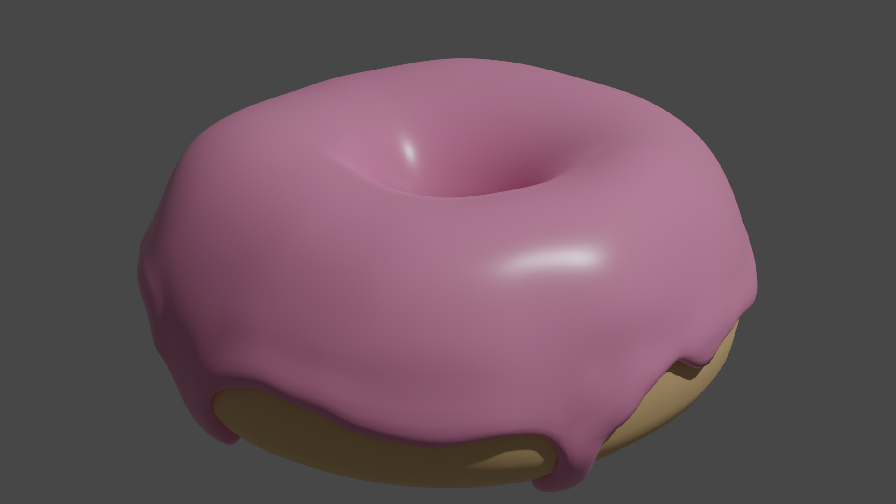
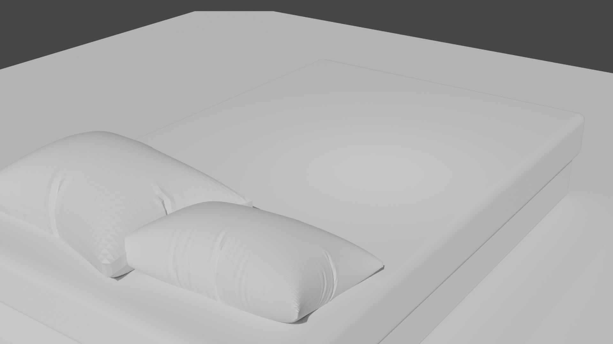

# 🎨 Blender 3D Art & Study Gallery

A curated showcase of 3D modeling, simulation, and environment art practices created with **Blender 3.6**.  
High-resolution stills rendered with the **Cycles Render Engine**.

> 💡 **Notice**: All projects in this repository were created for non-commercial personal study and skill practice, referencing various public tutorials and creative artworks by 3D artists.

---

## 🖼️ Gallery & Projects

### 🍄 Mushroom Terrarium in a Bottle
Stylized glass bottle terrarium containing mushrooms, foliage, and ambient sparkles with glass refractions and reflections.

  

* **Source File**: [`mushroom_vase.blend`](mushroom_vase.blend)
* **Highlights**: Glass shader refraction & reflection, organic mushroom modeling, magical ambient lighting

---

### 🏠 Snowy Winter Cabin Diorama
A cozy isometric winter scene featuring a snow-covered cottage, illuminated golden windows, open doorway, full courtyard base, and winter pine trees under moonlight.

  

* **Source File**: [`house.blend`](house.blend)
* **Highlights**: Volumetric snow layers, architectural diorama framing, warm interior emission lighting, moonlight atmosphere

---

### 🍩 Donut Tutorial Study
The classic 3D initiation study inspired by Blender Guru's iconic tutorial series, captured in a detailed close-up shot.

  

* **Source File**: [`donuttutorial.blend`](donuttutorial.blend)
* **Highlights**: Glossy dripping icing highlights, soft dough texturing, organic sculpted curves

---

### 🛏️ Pillow & Blanket (Cloth Simulation)
Bedding modeling practice exploring soft-body fabric dynamics, gravity, and realistic cloth folds.

  

* **Source File**: [`pillow,blanket.blend`](pillow,blanket.blend)
* **Highlights**: Cloth physics simulation, natural fabric wrinkles, soft-surface dynamics

---

## 📚 References & Cheatsheet
* [`Blender 3.0 HotKeys.pdf`](Blender%203.0%20HotKeys.pdf) — Quick reference cheat sheet for Blender hotkeys and navigation workflows.

---

## 📌 Credits & Disclaimer
* All models and renders are intended strictly for educational, personal skill development, and portfolio purposes.
* All original ideas, designs, and tutorial concepts belong to their respective creators and artists.
